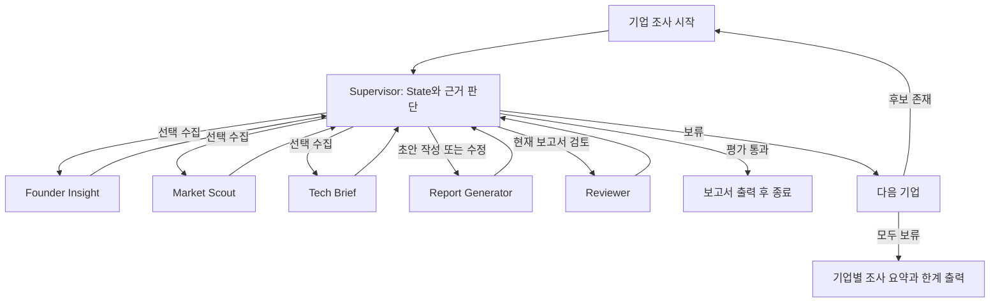

# Subject

본 프로젝트는 기업의 공개 자료를 창업자·기업(팀), 시장성, 기업 기술의 세 관점에서 조사하고, **Supervisor 기반 Multi-Agent 패턴**으로 근거를 종합해 중립적인 기업 소개 보고서를 생성하는 프로젝트입니다.

세 수집 Agent는 자료와 원문을 공통 State에 보존합니다. Supervisor는 현재 근거와 보고서 상태를 판단해 수집·작성·검토 작업을 선택하며, 보고서가 Groundedness·중립성·편향 통제 평가를 통과하면 종료합니다.

## Overview

- **Objective**: 하나의 기업을 복수 관점에서 조사하고, 실제 출처에 연결된 기업 소개 보고서 작성
- **Pattern**: Supervisor 기반 Multi-Agent Workflow
- **선정 이유**: 관점별 수집 역할을 분리하면서 추가 조사, 보고서 수정, 최종 종료를 현재 State에 따라 조정하기 위해 선정
- **동적 처리**: `add_conditional_edges`와 `Send`로 필요한 Worker를 선택·병렬 호출. 수집·작성·평가의 순서를 고정하지 않고 수집 결과와 평가 지적에 따라 분기
- **최종 결과**: 첫 승인 기업의 보고서 출력. 모든 후보가 보류되면 기업별 조사 요약과 작성·승인 한계를 포함한 보류 보고서 출력

## Selected Technologies

현재 조사 대상은 후보 기업과 해당 기업의 사업·제품·기술입니다. SW·HW 기술을 별도 비교 대상으로 선정하는 방식은 적용하지 않습니다.

구현에 선정한 주요 기술은 다음과 같습니다.

- **LangGraph**: State와 조건부 Edge를 이용한 Supervisor 분기 및 Worker 병렬 처리
- **FAISS·BM25**: 로컬 PDF에서 관련 근거 검색. 시장 RAG는 BM25 결합 검색 사용
- **Multilingual E5**: 한국어를 포함한 PDF 자료의 임베딩
- **Tavily**: 공개 웹 자료를 검색해 PDF 근거와 함께 활용
- **Pydantic**: 수집 결과·작업 계획·보고서·평가 결과의 구조 및 근거 연결 검증
- **ReportLab·PyMuPDF**: 한글 PDF 출력과 페이지 수 검사

후보 순서는 엔라이튼, 해줌, 식스티헤르츠, 시너지, 인코어드테크놀로지스, 브이피피랩, 브이젠, 에너지엑스, 크로커스에너지, 러셀입니다. `.env`의 `COMPANIES`로 변경할 수 있습니다.

## Features

- **PDF 자료 기반 정보 추출**: 시장 자료와 기업 기술 문서에서 관련 원문·페이지 검색
- **웹 기반 자료 수집**: 기업·창업자·시장·기술 관련 공개 자료 수집
- **공통 조사 계약**: 세 Agent가 `findings`, `evidence`, `raw_documents`, 미확인 사항과 검색 오류를 같은 구조로 반환
- **원본 데이터 보존**: 검색기가 반환한 raw 데이터를 State에 보존하고 보고서 작성에 활용
- **근거 추적**: 수집 모델은 실제 원문 구간을 선택. 코드가 Evidence와 연결하고 최종 보고서에는 실제 URL 또는 파일명·페이지 표시
- **동적 추가 조사**: 누락된 관점, 출처 충돌, 기업 식별 문제와 평가 지적에 따라 필요한 작업 선택
- **확증 편향 방지 전략**: 기업 주장과 독립 출처를 구분하고, 확보한 반대 근거·모순·자료 한계를 검토. 관련 외부 자료도 본문에 인용
- **상세 보고서 작성**: 장별 관련 자료로 작성한 뒤 원문과 대조해 편집하고, 완성된 본문으로 SUMMARY 생성
- **보고서 품질 평가**: Groundedness·중립성·편향 통제 검토. 미통과 지적은 실제 보고서 문장에 연결하고 발췌 존재 여부 검증
- **후보 순회**: 현재 기업이 보류되면 다음 후보로 이동. 첫 승인 보고서가 나오면 종료
- **PDF 출력**: 제목·작성일·SUMMARY·본문·REFERENCE 구성. SUMMARY 반 페이지, 각 장 2페이지, 전체 10페이지 이내 검사

보고서는 투자 점수·투자 추천·특정 기술 추천이나 우열 판정을 생성하지 않습니다. REFERENCE에는 사용한 자료 제목·URL·페이지를 표시하며, `출처 성격: unknown` 표시는 제외합니다. 같은 출처 위치는 중복 제거합니다.

## Tech Stack

| 구분 | 기술 및 설정 |
|---|---|
| Framework | LangGraph, LangChain OpenAI |
| LLM / Generator | 예시 설정: 창업자·시장 `gpt-4o-mini`, 기술·Supervisor·보고서 `gpt-4o`. Agent별 환경변수로 변경 가능 |
| LLM / Judge | `REVIEWER_MODEL`, 예시 설정 `gpt-4o` |
| Retrieval | 로컬 FAISS, 시장 RAG의 BM25 결합 검색 |
| Retrieval Metrics | Hit Rate@K·MRR 미측정 |
| Embedding | `intfloat/multilingual-e5-small` |
| Web Search | Tavily Search API |
| PDF Processing | PyMuPDF, LangChain PDF Loader, ReportLab |
| State / Validation | TypedDict, Annotated Reducer, Pydantic |
| Observability | 콘솔 logger, 외부 콜백, 선택적 LangSmith |

Supervisor·보고서·평가 모델이 미설정이면 `TECH_MODEL`, 그 값도 없으면 `gpt-4o`를 사용합니다. 수집 Agent는 각 모델 설정을 준비해야 합니다.

## Agents

| Agent | 역할 | 입력·활용 자료 |
|---|---|---|
| **Supervisor** | 근거 충분성과 현재 상태에 따라 작업 배정·보고서 작성·검토·종료 선택 | 조사 요약, 출처 메타데이터, 보고서·평가 상태, 실행 한도 |
| **Founder Insight** | 창업자와 기업의 배경을 폭넓게 조사 | 웹 검색 |
| **Market Scout** | 시장성과 사업 맥락을 조사 | 시장 PDF RAG, 웹 검색 |
| **Tech Brief** | 기업의 제품·기술을 조사 | 기술 PDF RAG, 웹 검색 |
| **Report Generator** | 관련 원문으로 장별 작성·편집 후 SUMMARY 생성 | 조사 요약, Evidence, raw 데이터, 이전 평가 지적 |
| **Reviewer** | 보고서의 근거 연결·중립성·편향 검토 | 보고서 전체와 검토용 Evidence |

Supervisor 아래의 수집 Worker는 세 개이며, 보고서 작성과 평가는 별도 노드입니다. 고정된 세부 조사 항목을 모두 채우도록 강제하지 않고 확보한 자료에 맞춰 조사·보고서를 구성합니다.

### 보고서 평가 기준

| 평가 항목 | 검토 내용 | 목적 |
|---|---|---|
| Groundedness | 원문이 실제 주장을 지지하는지, 인용·수치·시점·조건이 맞는지 | 출처 연결과 Hallucination 통제 |
| 중립성 | 기술 추천·우열 판정·투자 추천이나 근거 없는 평가가 없는지 | 기업·기술 소개 목적 유지 |
| 편향 통제 | 단일 출처 편중, 홍보 주장의 사실화, 확보된 반대 근거·모순의 누락 여부 | 확증 편향 방지 |

세 항목이 모두 통과하고 `issues`·`required_actions`가 비어 있어야 승인합니다. 평가 발췌의 형식 검증은 별도의 독립 사실 확인을 대신하지 않습니다.

## State Schema

State 구현은 `graph/supervisor_state.py`에 있습니다.

| 설계 항목 | 현재 구현 |
|---|---|
| **제어 vs 페이로드 분리** | 조사 결과는 `perspectives`, 보고서는 `report`, 평가는 `report_review`에 보관. `action`, `status`, 현재 작업·호출 횟수·버전 정보는 제어 메타데이터로 관리 |
| **관측성 위치** | 결정·사유·시각은 State 이력으로 누적하지 않고 콘솔 logger 또는 외부 `event_logger` 콜백으로 전달 |
| **지속성 비용** | 메모리 State만 사용하고 SQLite·파일 체크포인트는 사용하지 않음. 관점별 현재 결과에 원문을 병합하므로 추가 조사 시 메모리 사용량은 증가할 수 있음 |
| **상관** | `trace_id`로 기업별 실행 State와 외부 로그·추적 연결 |
| **재개/복구** | `node_status`, `node_attempts`, `node_errors`, `last_error`로 같은 실행 내 재시도 판단. 프로세스 종료 후 자동 복구는 지원하지 않음 |
| **동시 처리** | `Send`로 선택 Worker 병렬 호출. 관점·노드별 맵을 Reducer로 병합하고 동일 관점 중복 fan-out 금지 |
| **종료 보장** | 수집·작성·검토 예산, Supervisor 실행 상한, 연속 계획 실패 상한과 LangGraph recursion limit 적용. 한도 도달을 승인 사유로 사용하지 않음 |

### 주요 필드

- **입력·조사**: `company_name`, `research_request`, `product_names`, `research_tasks`, `perspectives`
- **제어·오류**: `trace_id`, `action`, `status`, `evidence_sufficient`, `step_count`, `node_status`, `node_attempts`, `node_errors`, `last_error`
- **상한**: `max_steps`, `max_research_attempts`, `max_report_attempts`, `max_retries`, `decision_failures`
- **보고서·버전**: `report_date`, `report`, `report_revision`, `report_basis`, `report_review`, `review_revision`, `verdict`

추가 조사 후에도 이전 초안과 평가 지적은 재작성에 전달합니다. `report_basis`와 `review_revision`으로 과거 평가가 최신 근거·보고서의 승인으로 사용되지 않도록 검사합니다.

모델 입력은 State 복사본에서 역할별로 선택·제한합니다. Supervisor에는 raw와 원문 발췌 본문을 전달하지 않고, 보고서 작성에는 해당 장의 관련 원문과 raw를 전달합니다. Reviewer에는 raw 대신 보고서와 Evidence를 전달합니다. 입력이 커지면 일부 원문을 축약하고 축약 사실을 알립니다.

### 기본 실행 상한

| 항목 | 기본값 |
|---|---:|
| 수집 Worker별·기업별 호출 | 6회 |
| 기업별 보고서 작성 노드 | 최대 3회 |
| 기업별 검토 노드 예산 | `3 × (max_retries + 1)`, 기본 9회 |
| Supervisor 누적 호출 | 100회 |
| 연속 계획 생성 실패 | 3회 |
| LangGraph recursion limit | 500 |

보고서 작성 한 번에는 장별 작성·편집과 SUMMARY 생성 등 여러 LLM 호출이 포함됩니다. 노드 호출 수와 API 호출 수는 다릅니다. RAG 인덱스와 최종 PDF는 파일로 저장되며, 조사 State의 외부 저장과는 구분합니다.

## Architecture



수집·작성·평가 노드의 결과는 Supervisor로 돌아옵니다. 다음 기업 이동과 전체 후보 보류 보고서 출력은 `app.py`가 담당합니다. 계획 계약·정책 오류는 재판단하며, 실제 노드 선택은 `add_conditional_edges`로 구현합니다.

## Directory Structure

```text
skala-rag/
├── data/                         # 시장·기술 PDF 문서 풀
├── agents/                       # 수집·조정·작성·평가 Agent
│   ├── contracts.py              # Pydantic 공통 계약
│   ├── collection.py             # 원문 선택과 공통 수집 처리
│   ├── input_limits.py           # 모델 입력 선택·길이 제한
│   ├── founder_insight.py
│   ├── market_scout.py
│   ├── tech_brief.py
│   ├── supervisor.py
│   ├── report_generator.py
│   ├── reviewer.py
│   └── pdf_export.py             # PDF 출력과 분량 검사
├── graph/
│   ├── graph.py                  # 노드·조건부 Edge·Send
│   ├── supervisor_state.py       # 현재 State와 Reducer
│   └── policy.py                 # 행동·버전·실행 상한 검증
├── prompts/                      # 프롬프트 템플릿
├── rag/                          # PDF 검색과 로컬 인덱스
├── outputs/                      # 최종 보고서 PDF
├── app.py                        # 후보 순회 및 실행 스크립트
├── requirements.txt
├── .env example                  # 설정 예시
└── README.md
```

`agents/investment_evaluator.py`, `graph/state.py` 등 이전 구현 파일도 남아 있지만 현재 Supervisor 실행 그래프는 투자 평가 모듈을 호출하지 않으며, State는 `graph/supervisor_state.py`를 사용합니다.

## Usage

Python 3.10 이상에서 가상환경을 만들고 의존성을 설치합니다. `.env example`을 참고해 저장소 루트의 `.env`에 키와 모델 설정을 준비합니다.

```bash
python3 -m venv .venv
source .venv/bin/activate
python -m pip install -r requirements.txt

# 설정된 후보 기업을 순서대로 조사
python app.py --no-trace

# 특정 기업 조사
python app.py --company 엔라이튼 --no-trace

# LangSmith 추적 사용
python app.py --trace
```

Windows PowerShell의 가상환경 활성화 명령은 `.venv\Scripts\Activate.ps1`입니다.

- **필수 인증**: `OPENAI_API_KEY`, `TAVILY_API_KEY`
- **모델**: `FOUNDER_MODEL`, `MARKET_MODEL`, `TECH_MODEL`, `SUPERVISOR_MODEL`, `REPORT_MODEL`, `REVIEWER_MODEL`
- **입력**: `COMPANIES`, `RESEARCH_REQUEST`
- **실행 상한**: `MAX_WORKFLOW_STEPS`, `MAX_RESEARCH_ATTEMPTS`, `MAX_RESEARCH_RETRIES`, `GRAPH_RECURSION_LIMIT`
- **선택적 추적**: `LANGSMITH_TRACING`, `LANGSMITH_API_KEY`, `LANGSMITH_PROJECT`

셸 환경변수가 `.env`보다 우선합니다. `.env example`에 남아 있는 점수·가중치·투자 추천 설정은 이전 모듈용이며 현재 Supervisor 실행에는 사용하지 않습니다.

실행 시 누락된 RAG 인덱스를 구축하고 기존 인덱스는 재사용합니다. 승인된 보고서는 `outputs/{기업명}_{작성일}.pdf`, 전체 보류 보고서는 `outputs/기업별_조사_보류_{작성일}.pdf`로 저장합니다. 조사 State는 프로세스 메모리에만 유지합니다.

파일 출력 없이 결과를 메모리에서 확인하려면 초기화 후 `build_graph().invoke(...)`로 직접 호출하고 `result['report']['markdown']` 또는 `result['verdict']`를 확인할 수 있습니다. `app.py` 기본 실행에는 PDF 저장이 포함됩니다.

## Contributors

- **강서현**: Prompt Engineering
- **김가은**: Agent 개발, 보고서·제품 기술 관련 구현
- **김태완**: Graph·State·Node·Edge 설계 및 Agent 연동
- **심지용**: 시장 PDF RAG 설계
- **엄진용**: 창업자·기업 및 시장 Agent 개발
- **유선일**: 제품·기술 PDF RAG 설계
